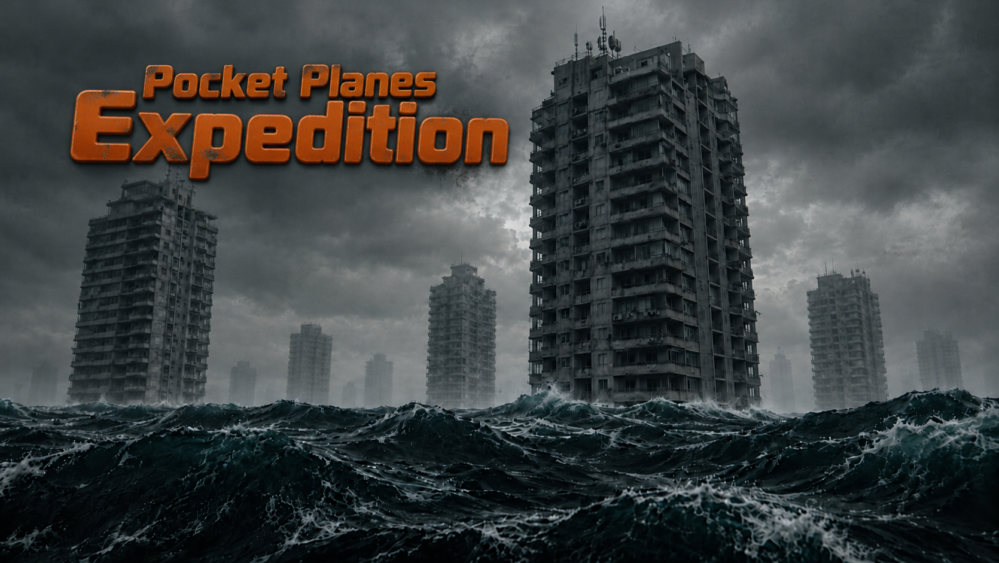

# Pocket Planes Expedition



**v0.5 Tech Demo** (2026-11-03) — live acceptance passed: WASM core, both bodies, sea/wind/rain/audio verified in the browser.

A game about exploring a pocket dimension: a night-time flooded city you fly through with an FPV
drone — and, when the drone can't go further, switch to the operator and keep going on foot.

**Game design:** [CONCEPT.md](CONCEPT.md) — the design bible: fantasy, entities, the weather as
the main enemy, honest-drift survival rules, roadmap and open questions.


---

## Quick start

```
npm install
npm run dev       # dev server with HMR
npm run build     # production build to dist/
npm run preview   # serve the build
npm test          # JS golden tests for the sea/wind reference model
```

three.js is pinned to **0.128.0** on purpose: lighting, color space and shaders are written for it.
Upgrading three means re-tuning lights (physical light units changed in r155) and the color pipeline.

## Controls

Mouse — heading/pitch, `W/S` — thrust, `A/D` — strafe, `Space/Shift` — up/down,
arrow keys and `Q/E` — yaw, `Tab` — switch drone ⇄ operator, `Esc` — pause, `L` — silent lightning (off by default).

## Project layout

```
PPE-graphics/
  main.js               scene assembly + main loop
  style.css             overlay, vignette, grain
  core/
    stage.js            renderer, scene, camera, shared uniforms (time, moon, fog), dispose
    geometry.js         slim(): strip unused attributes
  shaders/
    sky.js              sky GLSL (clouds, moon)
    ocean.js            ocean GLSL (waves, foam, moon trail)
  world/
    waves.js            wave model bridge: uniforms + DataTexture for the modulation field
    sky.js, ocean.js    sky and ocean meshes
    lights.js           hemisphere + directional (moon) light
    textures.js         procedural facade and foam textures
    city.js             seeded layout, merged geometry, foam, beacons, collisions
    rain.js             rain (line segments, dynamic buffer)
    atmosphere.js       moon arc, cloud cover, lightning (CFG, lightning)
  audio/audio.js        synthesized wind, rumble and splash — no samples
  flight/
    input.js            keyboard and mouse
    drone.js            drone physics and camera (JS, reads wind/hgt from the core)
    human.js            operator body rendering and camera (JS)
    human-phys.js       operator body physics (JS, same pattern as the drone)
  ui/overlay.js         start/pause and pointer lock
  sim/
    pp.js               WASM loader + JS views over the shared memory block
    sea.js              JS reference sea model (fallback)
    wind.js             JS reference wind model (fallback)
PPE-physics/
  src/lib.rs            WASM API boundary: PPState layout, exported C functions
  PPE-physics/src/sea.rs            sea model (port of sim/sea.js, bit-identical)
  PPE-physics/src/wind.rs           wind model (port of sim/wind.js, bit-identical)
  PPE-physics/src/rng.rs            JS-compatible RNG and hash (logical shifts!)
  PPE-physics/tests/sim.rs          golden tests against the JS reference
  PPE-physics/tests/golden.json     reference values dumped from Node
  PPE-physics/scripts/build.sh      rustc -> wasm32-unknown-unknown -> PPE-graphics/sim/pocket_physics.wasm
PPE-server/             vite.config.js (log-endpoint, wasm no-cache), dist/
test/
  sim.test.mjs          JS golden tests (14 checks)
  dump_golden.mjs       dumps sea state to golden.json for the Rust tests
  integration, smoke, human-model — integration checks over the real wasm
test/pp-test.html      standalone page: boots the WASM core and prints live values
```

## Conventions

- A module exports `createX(...)` returning its API; side effects live only inside create functions.
- Event listeners always take `{signal}` from `main.js` (otherwise they leak on HMR).
- No allocations in the per-frame path: reuse `Vector3`/`Color`.
- Static geometry is merged (`mergeBufferGeometries`); animated things stay separate meshes.
- Shader meshes strip unused attributes via `slim()`.
- Weather and moon parameters: `world/atmosphere.js`; waves: `sim/` (change JS and GLSL together).

## Physics core (Rust → WASM)

The environment simulation (sea + wind) lives in Rust and compiles to
`PPE-graphics/sim/pocket_physics.wasm` (~118 KB).
Bodies (drone, human) are JS modules that read the environment through one interface.
Rendering stays in three.js. The boundary is a single `#[repr(C)]` block at the start of
linear memory — JS creates `Float32Array` views **once** at init and only reads them per frame:
zero copies, zero `JsValue` traffic in the hot loop.

Exports (plain `extern "C"`, no wasm-bindgen):
`pp_init`, `pp_step(dt, t)`, `pp_hgt(x, z, t)`, `pp_at(x, y, z)`, `pp_set_obstacles(count)`, `pp_mod_ptr`.

`main.js` boots the WASM core first; if it fails to load, the game silently falls back to the
JS reference models in `sim/sea.js` / `sim/wind.js` — same formulas, same results, slower.

### Rebuilding the WASM core

```
cd PPE-physics && bash scripts/build.sh
```

Requires the `wasm32-unknown-unknown` std for your toolchain. The script drives `rustc` directly
(a Homebrew cargo may not see rustup-provided std for wasm targets); override the toolchain with
`RUST_TC=<name>`.

### Rules that keep the boundary alive

- **No allocations after `pp_init`.** Any growth of linear memory detaches every JS view
  (`Float32Array` starts returning `undefined`) and three.js dies in `flatten()` with
  `firstElem.toArray is not a function`. The obstacle buffer is preallocated to `MAX_OBST`
  in `Wind::new()` and filled with `clear()+push` — never `collect()`.
- **Don't double-unwrap the wind.** `updateSeaPP(dt, wind)` already reads `wind.u10`/`wind.dir`
  itself. Passing unwrapped numbers into it feeds `undefined` into an f32 param, which becomes
  `NaN`, which poisons the whole `w1` uniform array.
- The JS RNG port must use **logical** shifts (`>>>`): on `i32`, Rust's `>>` is arithmetic and
  the sea would silently run on a different seed.

### Tests

- `npm test` — 14 golden checks against the JS reference (dispersion, Pierson–Moskowitz,
  wind profile, wake behind buildings, modulation tiling).
- `cd PPE-physics && cargo test` — the same checks ported to Rust, plus a bit-for-bit comparison
  of `w1/w2/w3/ratio` and `hgt()` against `PPE-physics/tests/golden.json` (dumped from Node).

## Design document

The design targets (operator body, drone claw, floating container, two-body switching, shadow
entities, the leviathan) live in **[CONCEPT.md](CONCEPT.md)** and the audit notes.
